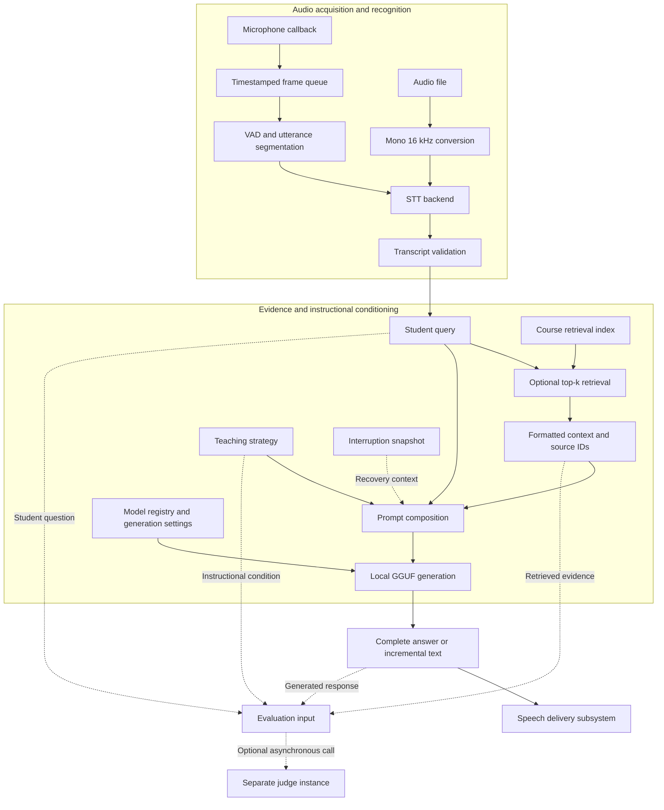
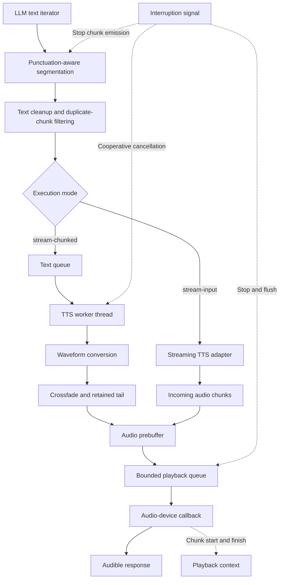
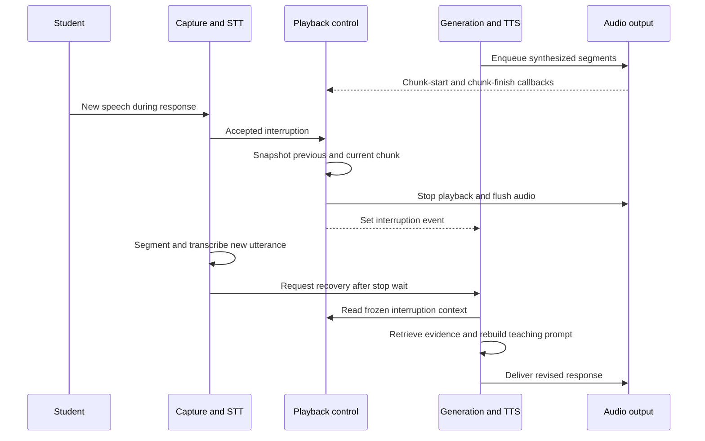

# StreamTutor

### Retrieval-augmented voice tutoring with streaming inference and structured evaluation

StreamTutor is a research system for spoken interaction with a Data Mining tutor. It integrates speech recognition, course-context retrieval, local language-model inference, and speech synthesis in a configurable pipeline. The central engineering question is how to reduce conversational delay while preserving factual grounding, pedagogical quality, and coherent spoken delivery.

Developed as a master's thesis project at Otto von Guericke University Magdeburg, the system supports controlled comparison of batch generation, incremental speech synthesis, and streaming text-to-speech input.

## Research questions and analytical framing

- **Responsiveness:** characterize the contribution of recognition, retrieval, generation, synthesis, and playback to perceived response latency.
- **Grounding:** examine whether retrieved course material improves the support and correctness of generated explanations.
- **Instructional behavior:** compare prompt-conditioned teaching strategies under a common evaluation protocol.
- **Interaction continuity:** support interruption and response reformulation using the student's new utterance and previously spoken content.

The experimental object is a configuration $c$ comprising recognition, retrieval, language model, instructional prompt, chunking policy, synthesis backend, and playback buffering. Its behavior is assessed through a latency distribution and a vector of quality judgments rather than a single headline score:

$$
\mathbf{Q}(c) = (Q_{\mathrm{correct}}, Q_{\mathrm{faithful}}, Q_{\mathrm{clear}}, Q_{\mathrm{complete}}, Q_{\mathrm{pedagogical}}).
$$

The research objective is to identify configurations with favorable latency–quality trade-offs. A configuration is Pareto-dominated when another is no worse on all declared objectives and strictly better on at least one. This framing avoids assuming that faster responses or longer explanations are intrinsically better.

| Research question | Controlled comparison | Principal outcomes |
|---|---|---|
| RQ1: How does incremental delivery affect responsiveness? | Batch, chunked, and streaming-input modes | First audible response, completion time, underruns |
| RQ2: What does retrieval contribute? | Same questions and generator, with and without retrieved evidence | Correctness, faithfulness, retrieval relevance |
| RQ3: How does instructional conditioning alter response quality? | Fixed model and evidence, varied teaching prompt | Strategy adherence, useful guidance, clarity |
| RQ4: How reliably does the tutor recover from interruptions? | Standardized interruptions across delivery modes | Stop latency, stale output, recovery relevance |

These are evaluation questions, not claims of established experimental findings.

## System architecture

The architecture comprises a foreground interaction pipeline, a playback-control path, and an optional evaluation path. The diagrams distinguish data dependencies from control signals; they describe the inspected Python runtime rather than assuming an unverified web deployment.

### 1. Recognition, retrieval, and response construction



**Evidence flow.** Retrieval uses the student's utterance, or the new interruption utterance, as its query. Retrieved passages condition response generation; identifiers accompany evaluation calls. This enables evidence-aware assessment, although retaining source IDs alone does not establish claim-level citation correctness.

**Instructional conditioning.** The prompt composer selects a teaching style and combines it with the query and available evidence. These styles define experimental conditions. The label `adaptive` denotes a prompt selection, not a demonstrated learner-state estimator.

### 2. Incremental synthesis and playback



The chunked path uses a producer–consumer arrangement: language-model generation supplies a text queue while a worker synthesizes segments. Audio playback runs through a separate device callback. The audio queue is bounded; the text queue in the inspected implementation is unbounded. Consequently, bounded playback buffering should not be interpreted as end-to-end backpressure.

Segmentation uses punctuation, character thresholds, and elapsed time. The inspected streaming path prebuffers approximately **0.9 seconds of generated audio** before release. This is an audio-duration threshold, not a fixed wall-clock delay. Crossfading is applied in the chunked path; equivalent behavior is not established for the HTTP streaming path.

### 3. Interruption and conversational recovery



The recovery prompt incorporates the new utterance and a snapshot of the previous completed chunk and the current chunk. The current chunk may have been heard only partially; therefore the snapshot approximates delivered context rather than providing word-level alignment. Chunked playback supplies text-associated callbacks, whereas the inspected HTTP streaming path enqueues audio without those text associations. Recovery-context fidelity must therefore be assessed separately by mode.

Stopping audio and stopping inference are distinct events. Cancellation is cooperative, and an in-flight synthesis call may continue after playback stops. The current recovery loop uses a bounded wait for the preceding pipeline; this is not proof of race-free cancellation. Speaker-mode heuristics filter likely feedback, but do not constitute acoustic echo cancellation.

## Capabilities

| Component | Implementation exposed by the source |
|---|---|
| Input | Microphone interaction and audio-file execution; mono 16 kHz audio loading |
| Recognition | Configurable STT backend factory; faster-whisper selected by default |
| Generation | Local GGUF inference through llama-cpp-python; registered Llama 3 and Qwen configurations |
| Retrieval | Optional course-context retrieval with configurable configuration file and top-k |
| Teaching | Socratic, adaptive, inquiry, and collaborative prompt selections |
| Synthesis | Chatterbox, HTTP streaming Chatterbox, and Kokoro backend selections |
| Playback | Bounded audio queue, playback callbacks, crossfading, and interruption controls |
| Evaluation | Optional separate judge model; asynchronous evaluation calls with context and run metadata |
| Instrumentation | STT, retrieval, generation, synthesis, and first-audio timing outputs |

Backend selections and evaluation hooks indicate integration support, not equivalent performance or validated effectiveness across configurations.

## Execution modes

| Mode | Response path | Experimental purpose |
|---|---|---|
| `batch` | Complete answer → synthesis → playback | Sequential baseline |
| `stream-chunked` | Incremental LLM output → text chunks → synthesis | Study overlap and chunk-size effects |
| `stream-input` | Incremental text → compatible streaming TTS backend | Study continuous text ingestion and audio delivery |

The streaming-input mode requires a backend that implements streaming text input. For HTTP Chatterbox, the corresponding synthesis service must be running. Selecting a streaming mode alone does not establish a real-time latency guarantee.

## Running an experiment

The examples below use the CLI options in `mic_stt_llm_tts.py`. Set `VOICE_ENTRYPOINT` to that file's location in your checkout. They assume the complete package structure, backend dependencies, model weights, and configuration files are available; the supplied source subset is not a standalone installation bundle.

```bash
export VOICE_ENTRYPOINT=/absolute/path/to/mic_stt_llm_tts.py

# Inspect available arguments.
python "$VOICE_ENTRYPOINT" --help

# Microphone input with chunked generation and Kokoro synthesis.
python "$VOICE_ENTRYPOINT" \
  --llm_model llama3_8b_q4 \
  --mode stream-chunked \
  --tts_backend kokoro \
  --teaching_style socratic \
  --speak

# File-based run with retrieval and a separately configured judge.
python "$VOICE_ENTRYPOINT" \
  --input sample.wav \
  --llm_model llama3_8b_q4 \
  --mode batch \
  --tts_backend chatterbox \
  --rag --rag_config configs/retrieval.yaml --rag_top_k 2 \
  --judge_model llama3_8b_q5 \
  --teaching_style socratic \
  --speak --save
```

Before execution, configure the GGUF paths in the model registry, provision the retrieval index, and install the selected recognition and synthesis dependencies. Microphone and speaker operation requires a working audio device and sounddevice support. GPU execution additionally requires compatible inference builds and device configuration. No hardware-independent memory or latency guarantee is assumed.

Important controls include `--stt_model`, `--stt_device`, `--stt_compute_type`, `--rag_top_k`, `--chunk_first`, `--chunk_mid`, `--chunk_later`, `--chunk_wait`, and `--crossfade_ms`. Use `--rag_print_context` to inspect the evidence supplied to generation.

## Evaluation methodology

Evaluation separates **system performance**, **answer quality**, and **instructional behavior**. A fluent response is not sufficient evidence of factual correctness, and a favorable automated score does not establish learning effectiveness.

### Latency and streaming behavior

The primary user-facing measure is **speech-end-to-first-audio latency**: elapsed time from the end of the student's utterance to the onset of audible tutor speech. Report this separately from LLM time to first token and total response completion time.

| Measure | Definition |
|---|---|
| Endpointing delay | Physical speech end to utterance-ready event |
| STT inference time | Recognition invocation to final transcript |
| Retrieval time | Retrieval invocation to formatted context availability |
| LLM TTFT | Generation invocation to first emitted text |
| TTS startup | First submitted text chunk to first playback onset |
| Response completion | Physical speech end to final playback completion |
| Interruption response | Student interruption onset to tutor playback cessation |

The current code exposes several internal timing events. Physical speech boundaries and audible output require additional measurement or validation; internal pipeline timestamps must not be relabeled as acoustic measurements. Because streaming stages overlap, their durations cannot be summed to recover end-to-end latency.

For comparative experiments, report p50 and p95, sample count, failures, hardware, model quantization, output length, and warm-up policy. Evaluate cold and warm runs separately. Judge-enabled and judge-disabled runs should also be distinguished: asynchronous evaluation can still compete for GPU memory and compute.

For a fully instrumented turn, let $t_e$ denote physical speech end, $t_u$ utterance readiness, $t_x$ transcript availability, $t_r$ retrieval completion, and $t_a$ first audible output. The critical-path decomposition is

$$
L_{\mathrm{response}} = t_a-t_e
= (t_u-t_e)+(t_x-t_u)+(t_r-t_x)+(t_a-t_r).
$$

The last term contains overlapping generation, chunk accumulation, synthesis, buffering, and device scheduling. It must be measured as a wall-clock interval. A fast first token does not imply a fast first spoken response.

**Instrumentation interpretation.** In the inspected streaming implementation, `first_audio_t` is recorded around queue release, not measured at the speaker. The corresponding value is a software proxy. Moreover, the interruption path initializes its total timer after transcription. Cross-mode comparisons require aligned timestamp origins before aggregation. Some TTS timing fields are populated only in the chunked path; unavailable values must remain missing rather than being treated as zero.

### LLM-as-a-Judge

The voice pipeline optionally invokes `LocalLLMJudge` using a separately selected model. Evaluation calls receive the question, generated answer, teaching style, retrieved context and identifiers, interruption context, and execution metadata. This supports context-aware assessment beyond reference-answer matching.

The following is the intended evaluation specification; the supplied files expose the integration calls but do not include the judge's internal rubric, score scale, output schema, or validation results.

| Dimension | Assessment criterion |
|---|---|
| Correctness | Technical claims agree with expert-verified domain knowledge |
| Faithfulness | Claims attributed to retrieved material are supported by that material |
| Clarity | Terminology, structure, and explanations are understandable and precise |
| Completeness | The response adequately addresses the question and its necessary qualifications |
| Pedagogical appropriateness | The response follows the selected strategy without revealing answers prematurely or withholding necessary guidance |

**Protocol.** Freeze the judge model, prompt, decoding settings, and rubric version. Evaluate configurations on the same held-out questions using criterion-specific scoring anchors. Require structured scores with brief evidence-based rationales; treat malformed outputs and failed judgments as explicit evaluation failures. Where retrieval provides insufficient evidence, distinguish unsupported claims from independently verified factual errors.

**Calibration.** Compare judge ratings with independent human annotations on a representative subset. Report agreement using a measure suited to the scale, such as weighted kappa for ordinal ratings, alongside dimension-level discrepancies. Assess sensitivity to response length, teaching style, and model family. A separately instantiated model is not necessarily an independent evaluator: shared model families and self-evaluation can introduce correlated preferences.

**Reporting.** Present dimension-level distributions and paired differences between configurations, with uncertainty estimated over questions. For repeated turns or generations, preserve question or dialogue grouping when estimating uncertainty. Avoid a single aggregate score unless its weighting is justified in advance. Automated ratings measure rubric adherence; claims about student learning require a separate learner study.

#### Evaluation record and validity controls

A reproducible judgment should associate the response with its question ID, configuration ID, evidence passages, reference answer where applicable, teaching condition, judge revision, rubric revision, dimension scores, rationale, and parse status. The existing integration passes the question, answer, context, source IDs, and run metadata; the complete record specification is a target for the evaluation implementation.

For paired configuration comparisons, compute per-question differences before aggregation:

$$
\Delta_d = \frac{1}{N}\sum_{i=1}^{N}\left[s_d(y_i^{A})-s_d(y_i^{B})\right].
$$

Here $s_d$ is a declared rubric score for dimension $d$. Numerical averages assume an explicit interpretation of score spacing; retain ordinal distributions and pairwise outcomes so conclusions do not depend solely on that assumption.

| Validity concern | Required experimental control |
|---|---|
| Self-preference and shared model errors | Human calibration; judge-family sensitivity analysis |
| Verbosity bias | Report response length and examine length-stratified disagreements |
| Position bias in pairwise evaluation | Randomize and reverse candidate order |
| Instruction leakage from evidence | Delimit retrieved text and answers as material to assess |
| Conflation of faithfulness and truth | Judge evidence support separately from reference correctness |
| Teaching-style mismatch | Score completeness relative to the instructional objective; a useful hint need not reveal the full solution |
| Generated versus heard response | Identify interrupted responses and assess delivered content separately |
| Evaluation interference | Isolate judging or report resource contention explicitly |

In batch mode, the asynchronous judge call is submitted before synthesis; in the streaming path, it is submitted after playback handling. These schedules differ and should be controlled when interpreting latency. An asynchronous API call alone does not guarantee negligible interference.

### Experimental comparisons

Use a fixed, expert-reviewed Data Mining question set with reference answers and relevant course passages. Compare retrieval enabled versus disabled, batch versus streaming, teaching strategies, and selected model or TTS configurations. Change one factor at a time, or use a declared factorial design, and retain prompts, retrieved identifiers, outputs, and configuration metadata.

Retrieval relevance, answer quality, and speech quality should be evaluated separately. Recall@k requires relevance annotations; WER requires reference transcripts. BLEU or BERTScore can supplement reference-based analysis but cannot substitute for factual verification or pedagogical assessment.

## Results and scope

No reproducible benchmark aggregate is published in this README. Performance claims should be added with the underlying question set, run configuration, measurement boundaries, and result artifacts. Historical timing observations from different machines or pipeline versions should not be presented as a controlled comparison.

The current evidence supports a research prototype with instrumented voice interaction and evaluation integration. Remaining validation priorities include calibrated judge ratings, repeated latency measurements, retrieval relevance annotations, acoustic interruption measurements, and robustness under speaker feedback. Prompt-conditioned teaching styles are experimental interventions; their availability does not establish adaptive student modeling or improved learning outcomes.

## Reproducibility and responsible use

Record the source revision, dependency versions, model identifiers and quantization, hardware, decoding parameters, retrieval configuration, prompt versions, and random seeds with each experiment. Preserve failed runs and document exclusions. Publish only course materials and audio for which redistribution is permitted; keep personal recordings, credentials, and downloaded model weights outside version control.

Model weights, synthesis voices, datasets, and course materials retain their respective licenses. Consult the repository's license file for code permissions. This system is intended for research and educational experimentation; generated explanations require verification against authoritative course material.
