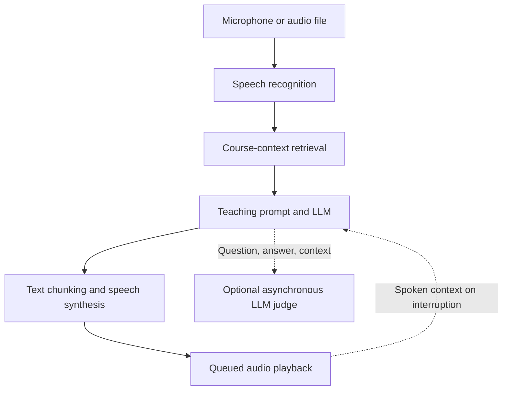

# StreamTutor

### Retrieval-augmented voice tutoring with streaming inference and structured evaluation

StreamTutor is a research system for spoken interaction with a Data Mining tutor. It integrates speech recognition, course-context retrieval, local language-model inference, and speech synthesis in a configurable pipeline. The central engineering question is how to reduce conversational delay while preserving factual grounding, pedagogical quality, and coherent spoken delivery.

Developed as a master's thesis project at Otto von Guericke University Magdeburg, the system supports controlled comparison of batch generation, incremental speech synthesis, and streaming text-to-speech input.

## Research objectives

- **Responsiveness:** characterize the contribution of recognition, retrieval, generation, synthesis, and playback to perceived response latency.
- **Grounding:** examine whether retrieved course material improves the support and correctness of generated explanations.
- **Instructional behavior:** compare prompt-conditioned teaching strategies under a common evaluation protocol.
- **Interaction continuity:** support interruption and response reformulation using the student's new utterance and previously spoken content.

## Architecture



Retrieval is optional. When enabled, retrieved passages are formatted into the teaching prompt, and their identifiers are retained for inspection and evaluation. Incremental generation feeds text into speech synthesis before the full response is complete. Punctuation-aware chunking and waveform crossfading address the trade-off between early playback and continuity across synthesized segments.

The implementation separates model providers, model registration, audio capture, text segmentation, synthesis, and playback. The supplied voice entry point uses the llama.cpp provider; a Hugging Face provider is also present in the language-model components.

## Capabilities

| Component | Implementation exposed by the source |
|---|---|
| Input | Microphone interaction and audio-file execution; mono 16 kHz audio loading |
| Recognition | Configurable STT backend factory; faster-whisper selected by default |
| Generation | Local GGUF inference through llama-cpp-python; registered Llama 3 and Qwen configurations |
| Retrieval | Optional course-context retrieval with configurable configuration file and top-k |
| Teaching | Socratic, adaptive, inquiry, and collaborative prompt selections |
| Synthesis | Chatterbox, HTTP streaming Chatterbox, and Kokoro backend selections |
| Playback | Bounded audio queue, playback callbacks, crossfading, and interruption controls |
| Evaluation | Optional separate judge model; asynchronous evaluation calls with context and run metadata |
| Instrumentation | STT, retrieval, generation, synthesis, and first-audio timing outputs |

Backend selections and evaluation hooks indicate integration support, not equivalent performance or validated effectiveness across configurations.

## Execution modes

| Mode | Response path | Experimental purpose |
|---|---|---|
| `batch` | Complete answer → synthesis → playback | Sequential baseline |
| `stream-chunked` | Incremental LLM output → text chunks → synthesis | Study overlap and chunk-size effects |
| `stream-input` | Incremental text → compatible streaming TTS backend | Study continuous text ingestion and audio delivery |

The streaming-input mode requires a backend that implements streaming text input. For HTTP Chatterbox, the corresponding synthesis service must be running. Selecting a streaming mode alone does not establish a real-time latency guarantee.

## Running an experiment

The examples below use the CLI options in `mic_stt_llm_tts.py`. Set `VOICE_ENTRYPOINT` to that file's location in your checkout. They assume the complete package structure, backend dependencies, model weights, and configuration files are available; the supplied source subset is not a standalone installation bundle.

```bash
export VOICE_ENTRYPOINT=/absolute/path/to/mic_stt_llm_tts.py

# Inspect available arguments.
python "$VOICE_ENTRYPOINT" --help

# Microphone input with chunked generation and Kokoro synthesis.
python "$VOICE_ENTRYPOINT" \
  --llm_model llama3_8b_q4 \
  --mode stream-chunked \
  --tts_backend kokoro \
  --teaching_style socratic \
  --speak

# File-based run with retrieval and a separately configured judge.
python "$VOICE_ENTRYPOINT" \
  --input sample.wav \
  --llm_model llama3_8b_q4 \
  --mode batch \
  --tts_backend chatterbox \
  --rag --rag_config configs/retrieval.yaml --rag_top_k 2 \
  --judge_model llama3_8b_q5 \
  --teaching_style socratic \
  --speak --save
```

Before execution, configure the GGUF paths in the model registry, provision the retrieval index, and install the selected recognition and synthesis dependencies. Microphone and speaker operation requires a working audio device and sounddevice support. GPU execution additionally requires compatible inference builds and device configuration. No hardware-independent memory or latency guarantee is assumed.

Important controls include `--stt_model`, `--stt_device`, `--stt_compute_type`, `--rag_top_k`, `--chunk_first`, `--chunk_mid`, `--chunk_later`, `--chunk_wait`, and `--crossfade_ms`. Use `--rag_print_context` to inspect the evidence supplied to generation.

## Evaluation methodology

Evaluation separates **system performance**, **answer quality**, and **instructional behavior**. A fluent response is not sufficient evidence of factual correctness, and a favorable automated score does not establish learning effectiveness.

### Latency and streaming behavior

The primary user-facing measure is **speech-end-to-first-audio latency**: elapsed time from the end of the student's utterance to the onset of audible tutor speech. Report this separately from LLM time to first token and total response completion time.

| Measure | Definition |
|---|---|
| Endpointing delay | Physical speech end to utterance-ready event |
| STT inference time | Recognition invocation to final transcript |
| Retrieval time | Retrieval invocation to formatted context availability |
| LLM TTFT | Generation invocation to first emitted text |
| TTS startup | First submitted text chunk to first playback onset |
| Response completion | Physical speech end to final playback completion |
| Interruption response | Student interruption onset to tutor playback cessation |

The current code exposes several internal timing events. Physical speech boundaries and audible output require additional measurement or validation; internal pipeline timestamps must not be relabeled as acoustic measurements. Because streaming stages overlap, their durations cannot be summed to recover end-to-end latency.

For comparative experiments, report p50 and p95, sample count, failures, hardware, model quantization, output length, and warm-up policy. Evaluate cold and warm runs separately. Judge-enabled and judge-disabled runs should also be distinguished: asynchronous evaluation can still compete for GPU memory and compute.

### LLM-as-a-Judge

The voice pipeline optionally invokes `LocalLLMJudge` using a separately selected model. Evaluation calls receive the question, generated answer, teaching style, retrieved context and identifiers, interruption context, and execution metadata. This supports context-aware assessment beyond reference-answer matching.

The following is the intended evaluation specification; the supplied files expose the integration calls but do not include the judge's internal rubric, score scale, output schema, or validation results.

| Dimension | Assessment criterion |
|---|---|
| Correctness | Technical claims agree with expert-verified domain knowledge |
| Faithfulness | Claims attributed to retrieved material are supported by that material |
| Clarity | Terminology, structure, and explanations are understandable and precise |
| Completeness | The response adequately addresses the question and its necessary qualifications |
| Pedagogical appropriateness | The response follows the selected strategy without revealing answers prematurely or withholding necessary guidance |

**Protocol.** Freeze the judge model, prompt, decoding settings, and rubric version. Evaluate configurations on the same held-out questions using criterion-specific scoring anchors. Require structured scores with brief evidence-based rationales; treat malformed outputs and failed judgments as explicit evaluation failures. Where retrieval provides insufficient evidence, distinguish unsupported claims from independently verified factual errors.

**Calibration.** Compare judge ratings with independent human annotations on a representative subset. Report agreement using a measure suited to the scale, such as weighted kappa for ordinal ratings, alongside dimension-level discrepancies. Assess sensitivity to response length, teaching style, and model family. A separately instantiated model is not necessarily an independent evaluator: shared model families and self-evaluation can introduce correlated preferences.

**Reporting.** Present dimension-level distributions and paired differences between configurations, with uncertainty estimated over questions. For repeated turns or generations, preserve question or dialogue grouping when estimating uncertainty. Avoid a single aggregate score unless its weighting is justified in advance. Automated ratings measure rubric adherence; claims about student learning require a separate learner study.

### Experimental comparisons

Use a fixed, expert-reviewed Data Mining question set with reference answers and relevant course passages. Compare retrieval enabled versus disabled, batch versus streaming, teaching strategies, and selected model or TTS configurations. Change one factor at a time, or use a declared factorial design, and retain prompts, retrieved identifiers, outputs, and configuration metadata.

Retrieval relevance, answer quality, and speech quality should be evaluated separately. Recall@k requires relevance annotations; WER requires reference transcripts. BLEU or BERTScore can supplement reference-based analysis but cannot substitute for factual verification or pedagogical assessment.

## Results and scope

No reproducible benchmark aggregate is published in this README. Performance claims should be added with the underlying question set, run configuration, measurement boundaries, and result artifacts. Historical timing observations from different machines or pipeline versions should not be presented as a controlled comparison.

The current evidence supports a research prototype with instrumented voice interaction and evaluation integration. Remaining validation priorities include calibrated judge ratings, repeated latency measurements, retrieval relevance annotations, acoustic interruption measurements, and robustness under speaker feedback. Prompt-conditioned teaching styles are experimental interventions; their availability does not establish adaptive student modeling or improved learning outcomes.

## Reproducibility and responsible use

Record the source revision, dependency versions, model identifiers and quantization, hardware, decoding parameters, retrieval configuration, prompt versions, and random seeds with each experiment. Preserve failed runs and document exclusions. Publish only course materials and audio for which redistribution is permitted; keep personal recordings, credentials, and downloaded model weights outside version control.

Model weights, synthesis voices, datasets, and course materials retain their respective licenses. Consult the repository's license file for code permissions. This system is intended for research and educational experimentation; generated explanations require verification against authoritative course material.
