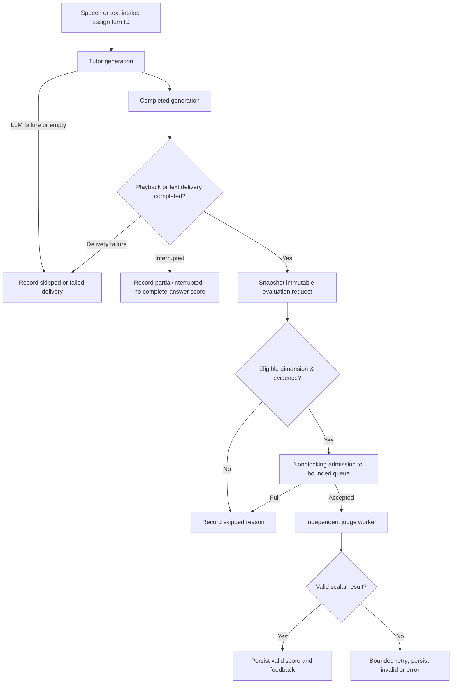

# StreamTutor — asynchronous runtime judge contract v1.0.0

**Status:** Implemented boundary validator and tests; **not yet integrated into the current tutor runtime**.  
**Date:** 2026-11-08.  
**Primary candidate:** `fare_20b_q4`; **explicit fallback candidate:** `compassjudger_2_7b_q4`. These are *provisional engineering choices* from the frozen v3 synthetic benchmark, not independently validated judges.  
**Scope:** Day 4 Task 4 — the interface and acceptance gates for Task 5 (integration) and Task 6 (end-to-end validation).

## 1. System boundary and observed code

The student-facing critical path is `VAD → STT → course retrieval → tutor LLM streaming → text chunking → TTS → playback`. Evaluation runs in a separate asynchronous worker, ideally on a separate model-serving resource. The evaluator must not block streaming, microphone capture, interruption, or audio output. LLM-as-judge is an *observer*, never a prerequisite for answering a student.

The **uploaded older** `app/mic_stt_llm_tts.py` uses `LocalLLMJudge.judge_and_log_async()` in both batch and streaming branches. In the streaming branch it is called **after** `audio_out.wait_done()` (if speaking). It receives a concatenated `full_answer_parts` answer but does not explicitly identify delivered words or stable turn IDs. There is no evidence here that this local JSON-oriented judge implements the frozen **scalar v3** `[RESULT] 1..5` contract or points to remote FARE. The current uncommitted `frontend_api.py` was **not provided**: its endpoint behavior and lifecycle remain unverified. Do not claim live integration based on this code alone.

### Explicit decision: assess *delivered* complete answers

For voice-mode, **generation completed** is not equivalent to **student heard the answer**. A generated response is eligible for normal complete-answer judging only once playback reaches completion (audio output has drained, no interruption) and the delivered-answer representation is verified. For text-only mode, eligibility begins when the complete answer has been successfully delivered to the client. An interruption during playback means **no complete-answer scalar judgment**, even if the LLM finished generating text. Record a skipped/partial event instead. This avoids silently grading words the student never heard; later research may evaluate partial answers using a separately versioned protocol.

Submission can occur once the final playback completion signal is observed; it must enqueue in bounded, nonblocking fashion. It is acceptable that the judgment finishes after the student begins the next turn. Never wait for the worker to respond from an audio callback.

## 2. Input contract

The pure Python boundary module `judge/runtime_contract_v1.py` defines `EvaluationRequest` with:

| Field | Invariant |
|---|---|
| `contract_version` | Exactly `1.0.0`; version any breaking change |
| `turn_id` | Unique stable identifier for a single user utterance/response attempt, created once at intake; never regenerated on retry |
| `conversation_id` | Stable non-secret pseudonymous session identifier; do not use student name |
| `outcome` | `delivered`, `interrupted`, `generation_failed`, `delivery_failed`, `empty` |
| `question_text` | Final STT transcript or text query, preserving exactly what tutor used; interruption turn gets **its own** ID |
| `generated_answer_text` | Exact complete tutor LLM response, independent of TTS processing |
| `delivered_answer_text` | Canonical text actually delivered to student (validated against the generated text at the semantic response level); for streaming audio, track chunk callbacks, don't assume full delivery from queued chunks |
| `generation_completed`, `delivery_completed` | Separate lifecycle events, both true for `delivered` |
| `history` | Ordered sanitized prior turn messages captured at time of inference; no later mutation |
| `evidence` | Exact retrieved text passed to LLM, source ID, rank, retrieval score if present, SHA-256; do **not** silently replace with current index content |
| `tutor_model_id`, `tutor_prompt_sha256`, `teacher_style` | Tutor generation provenance; capture chat/history packing and current prompt |
| `rubric_sha256`, `judge_model_id`, `judge_prompt_sha256`, `evaluation_dimension` | Judge provenance; exact v3 rubric/checksum and scalar prompt version |
| `interruption_parent_turn_id` | Optional pointer to interrupted turn, not replacement of turn identity |
| `metadata` | Restrict to approved flat strings, no keys, tokens, private filesystem paths, raw audio, or unnecessary personal data |

**Important implementation detail:** The current validator uses `generated_answer_text == delivered_answer_text` for a *complete* response. A TTS system may strip markup, normalize whitespace, or alter spoken rendering. Task 5 must define and test a **canonical spoken-text representation**; only mark `delivered` when the full semantic answer was delivered. Do not simply set the two strings equal without instrumenting playback completion. If the user can see full text while audio is interrupted, treat the text-display and audio-delivery channels separately and document the evaluation modality.

In v1, groundedness and retrieval relevance are **ineligible** without retrieved evidence; mark `skipped/no_retrieved_evidence`. A correctness/pedagogy score can still be eligible without RAG when explicitly supported by the rubric. Do not fabricate groundedness from an empty context.

## 3. Idempotency, queue, and storage

- **Evaluation identity:** SHA-256 of `(contract_version, turn_id, judge_model_id, judge_prompt_sha256, rubric_sha256, evaluation_dimension)`; this is stable across retries but intentionally changes when the judge version, rubric, or criterion changes.
- **Immutable payload:** store `payload_hash` of question, delivered answer, history, evidence, tutor identity, and teaching style. If an existing idempotency key reappears with a different payload hash, treat it as a **conflict**, log and alert, do **not** overwrite.
- **Queue:** use a bounded in-memory queue initially (e.g. 32 requests) with `put_nowait()`. **Never** enqueue from the audio callback; schedule in the event/response layer after delivery completion. A full queue must yield an auditable `SKIPPED` record (`queue_full`), not block the tutor.
- **Durability:** a bounded in-memory queue is not durable across process crashes. For the minimum Task 5 prototype, persist an atomic *accepted/queued* event before or with queue admission; restore pending jobs on restart. Alternatively use an existing durable work queue. Do not claim exactly-once processing; target **at-least-once delivery + idempotent writes**.
- **Worker:** one inflight request by default for an A40-hosted evaluator; bounded total attempts (e.g., 2 = 1 initial + 1 retry) only for transient transport errors and incomplete/invalid scalar output. Record all attempts, elapsed time, outcome, reason, server model and token limits. Model switching requires an explicit new evaluation identity and separate record.
- **Output contract:** scalar v3 valid result = parsed `[RESULT] N` with integer `1..5` and evidence-based feedback (final model format parser reused from frozen judge code). `INVALID` / `ERROR` / `SKIPPED` have **null score**, never zero or neutral default. Store raw output (subject to privacy policy), parsed output and parser version.
- **Failure containment:** timeout, server unavailable, queue overflow, invalid result, process shutdown, and cancellation cannot prevent the tutor response. No implicit synchronous fallback to another judge model. The client may expose judge status *later* but must not wait for it.
- **Retention/privacy:** do not log audio or credentials; consider pseudonymous IDs, redaction of personal STT content, controlled access, retention period, and delete procedure before collecting real students' data. Academic research approval/consent arrangements are outside this code contract.

## 4. Lifecycle/state machine



Allowed status transitions: `queued → running → valid/invalid/error`, or `queued → skipped` when worker shutdown is explicitly recorded. Retry attempts belong to one evaluation identity; an interrupted *tutor turn* never transitions into a delivered turn after cancellation. Enforce uniqueness on the evaluation idempotency key and commit attempt history atomically.

## 5. Timing/telemetry contract

Clock on client: `time.perf_counter()` monotonic only; report elapsed intervals, not arithmetic between machines' raw monotonic values. Capture timestamps for utterance readiness, STT completed, retrieval completed, first LLM delta, first TTS chunk available, **audio callback first non-silent frames**, generation complete, playback drained/interrupted, enqueue attempted/accepted, judge request start, judge response, parse end, persistence end.

**Perceived tutor latency:** time from **utterance end/VAD endpoint** to first audible playback onset proxy; separately report VAD endpointing delay when measurable. `enqueue_audio_chunk()` or `AudioOutput.enqueue()` timestamps are *not* proof of audible onset. Instrument `AudioOutput._callback` for the earliest audio frames written to output buffers (and declare it an approximate onset, since device buffering remains).

**No-interference experimental gate:** run paired/repeated trials with judge disabled/enabled and with slow/unavailable/full-queue judge. Freeze the same STT input, retrieval index, tutor model, prompt, hardware contention, and TTS configuration. Report p50/p95 of endpoint-to-audio latency and per-component times, jitter/underruns, and turn completion/failure; paired confidence intervals clustered by utterance/scenario. Do not claim `0 ms` overhead from async design alone. Separate a dedicated-GPU experiment from a shared-GPU interference experiment.

## 6. Task 5 mapping and non-regression acceptance tests

| Task 5 integration requirement | Acceptance evidence |
|---|---|
| Stable turns and interruption provenance | Same `turn_id` across queue retry; new ID on interruption; parent link |
| Finalized delivered-only eligibility | If interruption after LLM completes but before audio drain: **0 complete-answer jobs** |
| Exactly one stored result per judge config and dimension | Repeated enqueue cannot create duplicate; payload conflict rejected |
| Complete captured RAG context | Retrieved source IDs / ranks / exact context hashes match prompt context snapshot |
| No RAG evidence for groundedness | Observable `skipped/no_retrieved_evidence` instead of score |
| Queue backpressure & judge unavailable | Tutor still speaks; request marked skipped/error with reason |
| Invalid parser / timeout / retry | Attempt history and null final score; bounded retries |
| Versioned remote FARE scalar service | Uses v3 scalar prompt/parser; no fallback to legacy JSON judge |
| Voice latency non-interference | Paired baseline vs enabled, unavailable, slow, queue-full; compare first audio and underruns |
| Data privacy and persistence | No credentials/raw audio in logs; crash/restart pending-job recovery test |

### Explicit non-goals for Task 4

This package does **not** launch FARE, modify live tutor code, provide a queue implementation, certify A30 deployment, or run end-to-end latency tests. Those belong to Tasks 5–7. The accompanying validator is pure and unit-tested; Task 5 must adapt it to the actual frontend/current runtime code rather than replacing that code wholesale.

## 7. Reproduction and source control

From repository root after copying the two `judge/` files:

```cmd
.\.venv\Scripts\python.exe -m unittest judge.test_runtime_contract_v1 -v
.\.venv\Scripts\python.exe -m unittest discover -s judge -t . -p "test_*v3.py" -v
```

Commit **only** `judge/runtime_contract_v1.py`, `judge/test_runtime_contract_v1.py`, and this document. Keep benchmark evidence ZIPs, `__pycache__`, credentials, and generated results outside the commit. This contract is a new source artifact and must not rewrite frozen v3 benchmark outputs.
